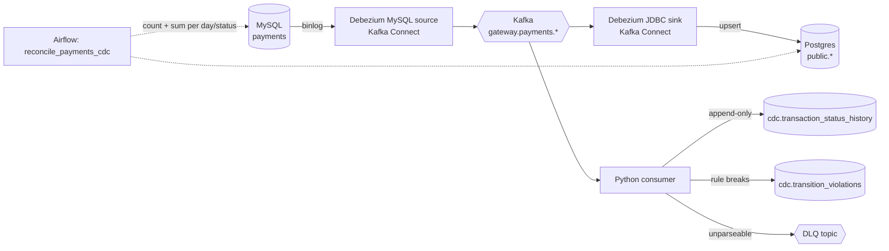

# payments-cdc-pipeline

Change data capture for a payments ledger. Every insert, status change and delete on a MySQL `transactions` table is read from the binlog by Debezium, published to Kafka, and written to a Postgres warehouse by the Debezium JDBC sink. A Python consumer reads the same stream to keep a full status history and flag changes that should never happen, like a failed payment turning into a successful one. A daily Airflow job reconciles source and warehouse by count and by amount.



## Why CDC for payments

Batch extracts that query `WHERE updated_at > last_run` see each row once per run. A transaction that goes `pending -> failed -> success` between runs shows up as `success`, and the `failed` step is lost. They also miss hard deletes completely. The binlog records every change in commit order, so CDC keeps the intermediate states, captures deletes, and puts no extra query load on the production database.

## Run it

You need Docker. Everything else runs in containers.

No credentials are committed. The first `make` copies `.env.example` to `.env` (ignored by git) with a random password in place of every `change-me`. Docker Compose reads `.env`, and the connector configs in `connectors/` refer to `${env:...}`, which Kafka Connect's `EnvVarConfigProvider` resolves at runtime. On Kubernetes the same connectors read Kubernetes secrets through Strimzi's `KubernetesSecretConfigProvider`.

```bash
make demo
```

This starts MySQL, Kafka (KRaft, no ZooKeeper), Kafka Connect with Debezium, Postgres and the consumer, then:

1. registers the source and sink connectors and waits until both are `RUNNING`
2. generates 500 transactions and moves them through their lifecycle, with 5 deliberate illegal changes (`failed -> success`)
3. reconciles MySQL against Postgres for today, retrying for up to 2 minutes while the pipeline catches up
4. prints the violations the consumer flagged

Then look around:

```bash
make status       # connector and task state
make history      # status history for recent transactions
make violations   # flagged rule breaks
make down         # stop and delete everything
```

To run the same pipeline on Kubernetes (k3d, with Strimzi running Kafka and Kafka Connect, and Terraform installing the Helm chart): `make k8s-up k8s-demo`. See [deploy/local](deploy/local/README.md).

To run the reconciliation DAG in Airflow: `docker compose --profile airflow up -d airflow`, then open http://localhost:8080 (the admin password is printed in `docker compose logs airflow`).

## What each piece does

| Piece | Where | Notes |
|---|---|---|
| Source schema | `mysql/init/01_schema.sql` | Money as `BIGINT` minor units (kobo, pesewas, cents). Binlog in `ROW` format with full row images, so updates carry the before state. |
| Debezium source | `connectors/mysql-source.json` | Initial snapshot, then streams the binlog. One topic per table, keyed by primary key. |
| JDBC sink | `connectors/postgres-sink.json` | Upserts by primary key, applies deletes, adds new columns when the source schema changes. A `RegexRouter` maps `gateway.payments.transactions` to the table `transactions`. |
| Consumer | `src/cdc/consumer.py` | Builds the status history and checks every change against the lifecycle rules in `state_machine.py`. |
| Reconciliation | `src/cdc/reconcile.py`, `airflow/dags/` | Compares count and sum of `amount_minor` per day and status. Exits non-zero on a mismatch. |
| Deployment | `deploy/helm`, `deploy/terraform`, `deploy/local` | Helm chart for the consumer, Strimzi `KafkaConnector` resources and a reconciliation CronJob; Terraform that installs it with its secret; a local k3d setup that runs all of it. |

## Design decisions

**Two sinks from one stream.** The JDBC sink keeps the current state of each row, which is what reporting needs. It cannot answer "how long did this payment sit in pending" or "was it ever marked failed". The consumer writes every status change to an append-only table instead. Both read the same topic with different consumer groups, so neither slows the other down.

**Idempotent writes, offsets committed last.** The consumer writes a batch to Postgres in one transaction and only then commits Kafka offsets. If it crashes in between, it re-reads the batch on restart. Each history row is keyed by the binlog position (`file:pos:row`) with `ON CONFLICT DO NOTHING`, so a replay inserts nothing new. This is at-least-once delivery with an effectively-once result in the table. It does not claim exactly-once end to end.

**Ordering.** Debezium keys each message by primary key, and Kafka keeps order within a partition, so all changes to one transaction arrive in order. The consumer can be scaled up to the partition count without breaking per-transaction ordering.

**Flag, don't drop.** A change that breaks a rule (`failed -> success`, an amount edited after settlement, a hard delete) still gets written to the history, because it really happened in the source. It is also written to `cdc.transition_violations` so someone looks at it. Only messages that cannot be parsed at all go to the dead-letter topic, with the reason and original offset in the headers.

**Reconcile on money, not just rows.** Matching row counts can hide a truncated amount or a wrongly routed update. The daily check compares the sum of amounts per status as well as the counts.

## Tests

```bash
make test          # unit tests: parsing, lifecycle rules, reconciliation, store and consumer logic
make up register
make integration   # writes to MySQL, waits for CDC, checks Postgres matches and violations were caught
```

CI (`.github/workflows/ci.yml`) runs lint, unit tests, `helm lint`, `terraform validate`, an Airflow DAG import check, and the full end-to-end test against the Docker stack on every push.

## Limitations

- Single Kafka broker and JSON with embedded schemas. In production I would use a 3-broker cluster and Avro or Protobuf with a schema registry.
- The consumer has no metrics endpoint yet. Consumer lag is the number to alert on, and Kafka exposes it per group.
