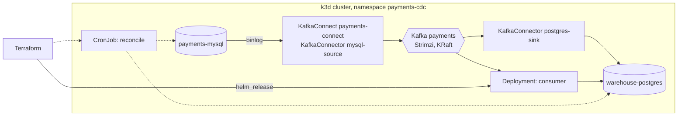

# Local Kubernetes deployment

Runs the pipeline on a single-node k3d cluster, deployed the same way it would be on EKS or GKE:

- **Strimzi** runs Kafka (KRaft, no ZooKeeper) and a Kafka Connect cluster built with the Debezium MySQL source and JDBC sink plugins.
- **Terraform** (`deploy/terraform`) creates the namespace and the warehouse secret, then installs the **Helm** chart.
- The chart deploys the consumer, creates the two `KafkaConnector` resources and the daily reconciliation `CronJob`.
- Connector credentials stay in Kubernetes secrets. Connect reads them at runtime through Strimzi's `KubernetesSecretConfigProvider`, and an RBAC role lets it read only those two secrets.

It costs nothing and needs no cloud account.



## Requirements

Docker with at least 4 GB of memory, plus `k3d`, `kubectl`, `helm` and `terraform`:

```bash
brew install k3d kubectl helm hashicorp/tap/terraform
```

## Run

```bash
deploy/local/up.sh     # cluster, images, Strimzi, databases, Kafka, Terraform + Helm (about 5 minutes the first time)
deploy/local/demo.sh   # 500 transactions with 5 illegal changes, reconcile, show violations
deploy/local/down.sh   # delete the cluster
```

Look around:

```bash
kubectl --context k3d-payments-cdc -n payments-cdc get pods,kafka,kafkaconnect,kafkaconnectors,cronjobs
kubectl --context k3d-payments-cdc -n payments-cdc logs deploy/payments-cdc-payments-cdc -f
kubectl --context k3d-payments-cdc -n payments-cdc create job --from=cronjob/payments-cdc-payments-cdc-reconcile reconcile-manual
```

## What is different from production

| Here | Production |
|---|---|
| 1 Kafka node, replication factor 1, ephemeral storage | 3+ brokers, RF 3, `min.insync.replicas` 2, persistent volumes |
| MySQL and Postgres as pods with `emptyDir` | Managed databases (RDS, Aurora) with their own Terraform modules |
| Images imported into k3d | Images pushed to a registry by CI |
| Passwords generated into `.env` and loaded into Kubernetes secrets by `up.sh` | A secret store (AWS Secrets Manager via External Secrets) |
| Local Terraform state | Remote state with locking (S3 + DynamoDB) |
